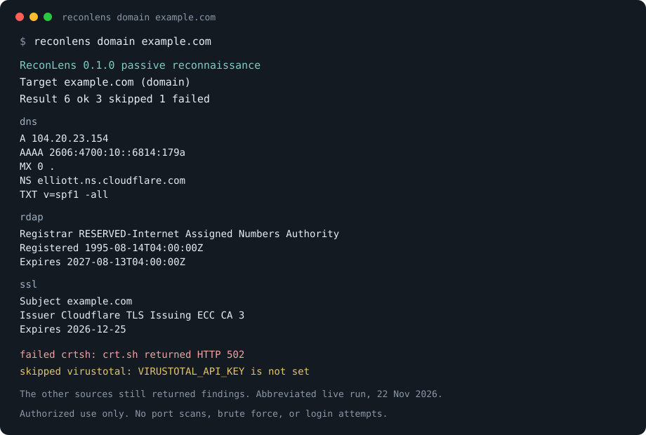

<p align="center">
  
</p>

<p align="center">
  <a href="https://github.com/codedbyasim/reconlens/actions/workflows/ci.yml"></a>
  <a href="LICENSE"></a>
  <a href="https://www.python.org/downloads/"></a>
  <a href="CHANGELOG.md"></a>
  <a href="CODE_OF_CONDUCT.md"></a>
</p>

ReconLens is a passive OSINT command-line tool for domains, IP addresses, email
addresses, and usernames. Each data source is a small plugin. One slow or
failing source does not throw away the rest of the run.

It is meant to be pleasant to use and easy to extend. The contribution surface
is a base class, an entry point, and a test with a mocked response.

## Ethical use

ReconLens queries public records and read-only APIs. It does **not** scan ports,
brute-force names, bypass authentication, or attempt logins. Keyed sources that
could submit work elsewhere are lookup-only: urlscan is searched and not asked
to scan, and Shodan is queried and not asked to probe a host.

Use it only on targets you own or are authorized to assess. You are responsible
for the law that applies to you and for each provider's terms. Requests are
rate-limited and send an identifying User-Agent:

```text
ReconLens/0.1.0 (+https://github.com/codedbyasim/reconlens; passive-osint; authorized-use-only)
```

The same notice is in `reconlens --help`.

## Demo

Abbreviated live run against `example.com` on 22 Nov 2026. crt.sh returned
HTTP 502 that day. DNS, RDAP, the certificate, headers, policy files, and the
Wayback Machine still produced findings.

<p align="center">
  
</p>

## Features

- Four commands: `domain`, `ip`, `email`, `username`, plus `sources` and `report`.
- Async runs. Each source has its own timeout. Exceptions stay inside that source.
- Normalized findings: category, severity, value, source URL, and a UTC timestamp.
- Reports: a Rich terminal view, Markdown, self-contained HTML, and JSON (schema 1.x).
- Optional on-disk cache (`chmod 600` files, no API keys stored).
- Outbound HTTP is HTTPS-only and refuses loopback, link-local, and other non-public addresses.
- API keys come from the environment or a config file. They are not printed, and they are scrubbed if a plugin echoes one.

## Install

Python 3.10 or newer.

```bash
git clone https://github.com/codedbyasim/reconlens.git
cd reconlens
python -m pip install -e ".[dev]"   # contributors
# or
python -m pip install .             # just the CLI
```

`pipx install reconlens` will work after the first tagged release. Publishing
uses PyPI trusted publishing and does not store a token in this repository.
See [docs/releasing.md](docs/releasing.md).

## Quickstart

```bash
reconlens domain example.com
reconlens ip 1.1.1.1
reconlens email user@example.com
reconlens username octocat
reconlens sources
reconlens domain example.com --output json --out example.json
reconlens domain example.com --output html --out example.html
reconlens report --input example.json --output md --out example.md
```

`--output` is `text` (the default Rich view), `md`, `html`, `json`, `csv`, or
`jsonl`.
`--out` writes `md`, `html`, `json`, `csv`, or `jsonl` to a file. JSON on stdout stays clean
so you can pipe it. `--quiet` skips the terminal summary.

Exit codes: `0` when the run finished (individual source failures are reported,
not fatal), `1` when every selected source failed, a report could not be
written, or `--fail-on-error` saw a source error, and `2` for a bad target or
unknown flag.

## Example

A live `reconlens ip 1.1.1.1` returned, among other rows:

```text
rdap     Name          APNIC-LABS
rdap     Network       1.1.1.0/24
ip-geo   Location      Brisbane, Queensland, Australia
ip-geo   ASN           AS13335
```

A live `reconlens email user@example.com` returned:

```text
email-auth   Null MX                         0 .
email-auth   SPF rejects unmatched senders   v=spf1 -all
email-auth   DMARC policy is reject          v=DMARC1; p=reject; ...
gravatar     Gravatar                        not present
hibp         skipped                         HIBP_API_KEY is not set
```

Have I Been Pwned runs only when `HIBP_API_KEY` is set. Query an address only
when you are authorized to.

## Sources

| Source | Targets | Key | What it reads |
| --- | --- | --- | --- |
| `dns` | domain | none | A, AAAA, CNAME, MX, NS, TXT, SOA, CAA |
| `email-auth` | email | none | MX, SPF, DMARC; BIMI, MTA-STS, and TLS-RPT when published |
| `rdap` | domain, ip | none | Registration data over RDAP (structured WHOIS) |
| `ssl` | domain | none | The certificate from one TLS handshake to port 443 |
| `crtsh` | domain | none | Unexpired names from the public crt.sh search |
| `http-headers` | domain | none | One HTTPS GET of the origin, then the response headers |
| `robots` | domain | none | `robots.txt` and `security.txt`, summarized, links not followed |
| `wayback` | domain | none | Recent public Wayback CDX snapshots (no new capture is requested) |
| `ip-geo` | ip | none | Country, network, and ASN from ipwho.is. Private addresses are not sent |
| `ripestat` | ip | none | Prefix and origin ASN from RIPEstat network-info (no holder name). Private addresses are not sent |
| `gravatar` | email | none | Whether Gravatar has an image (the MD5 avatar URL) |
| `username` | username | none | Public profile URLs from a small curated list |
| `virustotal` | domain, ip | `VIRUSTOTAL_API_KEY` | Existing reputation. Nothing is submitted for analysis |
| `abuseipdb` | ip | `ABUSEIPDB_API_KEY` | Abuse confidence. No report is filed |
| `urlscan` | domain | `URLSCAN_API_KEY` | Existing public results. No scan is submitted |
| `shodan` | domain, ip | `SHODAN_API_KEY` | Passive DNS or a stored host record. Ports are Shodan's history |
| `hibp` | email | `HIBP_API_KEY` | Public breach names for an address you are authorized to check |

`reconlens sources` prints this list and whether a key is configured. It never
prints the key.

The username catalog is
[`src/reconlens/data/username_sites.json`](src/reconlens/data/username_sites.json).
Adding a site is a data change: `{username}` may appear once, and only in the
path or query. A 200 means the public URL responded. Open the page before you
treat it as the same person.

## Reports

| Format | Command |
| --- | --- |
| Terminal | `reconlens domain example.com` |
| JSON | `--output json --out report.json` |
| Markdown | `--output md --out report.md` |
| HTML | `--output html --out report.html` |
| CSV | `--output csv --out report.csv` (one row per finding) |
| JSON Lines | `--output jsonl --out report.jsonl` (one finding per line) |

The HTML report is one file: the stylesheet is inline, and there are no remote
fonts or scripts. The JSON shape is
[docs/report.schema.json](docs/report.schema.json) (schema 1.x). Re-render a
saved JSON report with `reconlens report`.

## Configuration

Keys and cache settings can live in `./reconlens.toml` or
`~/.config/reconlens/config.toml`. Copy [config.example.toml](config.example.toml).
Environment variables override the file.

```bash
export VIRUSTOTAL_API_KEY="..."   # never commit this
export RECONLENS_CACHE=1
export RECONLENS_CACHE_TTL=3600
```

`RECONLENS_CONFIG` points at a specific file. If that path is missing, the CLI
exits instead of silently ignoring it. Details:
[docs/configuration.md](docs/configuration.md).

## Plugins

A source is a subclass of `Source` plus an entry point in the
`reconlens.sources` group. Third-party packages are discovered the same way as
the built-ins. The 10-minute path is in
[CONTRIBUTING.md](CONTRIBUTING.md#write-your-first-plugin-in-10-minutes), and the
copy-paste module is
[`src/reconlens/plugins/_template.py`](src/reconlens/plugins/_template.py).

```python
from reconlens import Source, TargetType, make_finding

class ExampleSource(Source):
    name = "example"
    description = "One public HTTPS lookup."
    target_types = frozenset({TargetType.DOMAIN})

    async def run(self, target, ctx):
        response = await ctx.get_public(
            "https://example.com/api",
            source=self.name,
            min_interval=self.min_interval_seconds,
            params={"q": target.value},
        )
        return [make_finding(source=self.name, category="infrastructure", title="Result", value=target.value)]
```

Use `ctx.get_public` or `ctx.request`. That path applies the rate limit, the
User-Agent, and the public-host guard. Do not open sockets to other ports.

## Development

```bash
python -m venv .venv
source .venv/bin/activate
python -m pip install -e ".[dev]"
make ci    # ruff, ruff format --check, mypy, pytest with coverage
```

Tests mock the network (`respx` plus stand-ins for DNS and TLS). CI does not
need live network access. The workflow runs on Python 3.10, 3.11, 3.12, and 3.13.

Optional docs site:

```bash
python -m pip install -e ".[docs]"
mkdocs serve
```

## Roadmap

- RIPEstat, AlienVault OTX, and SecurityTrails as more passive sources.
- DNSSEC checks, and fetching the MTA-STS policy file (the DNS record is already read).
- CSV and JSON Lines output, a batch file of targets, and a report diff.
- A small self-contained filter on the HTML report.
- `reconlens doctor`, which reports which keys are set without printing them.

Concrete starter tasks are written so they can be pasted into GitHub issues:
[docs/good-first-issues.md](docs/good-first-issues.md).

## Documentation

- [Architecture](docs/architecture.md)
- [Plugin API](docs/plugin-api.md)
- [Reports](docs/reports.md)
- [Configuration](docs/configuration.md)
- [Ethics](docs/ethics.md)
- [Releasing](docs/releasing.md)

## Contributing

Issues and pull requests are welcome. Read [CONTRIBUTING.md](CONTRIBUTING.md)
and the [code of conduct](CODE_OF_CONDUCT.md). Security reports go through
[SECURITY.md](SECURITY.md), not a public issue.

Plugins that scan, guess names, or try to log in will be closed.

## License

[MIT](LICENSE). Copyright (c) 2026 Muhammad Asim.

Data returned by crt.sh, RDAP, the Wayback Machine, ipwho.is, Gravatar, and the
optional APIs belongs to those providers. Review their terms before you send
them traffic in bulk.
