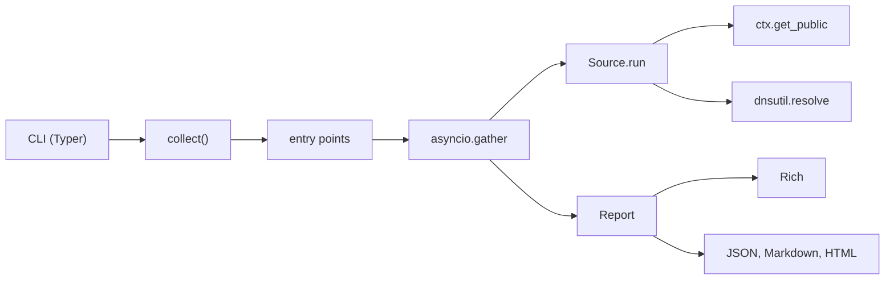

# Architecture

A run has four stages.

## Packages

| Module | Role |
| --- | --- |
| `cli` | Parses the target, loads config, prints or writes the report |
| `validate` | Turns user input into a `Target` |
| `config` | TOML file plus environment. Keys are omitted from `repr` |
| `plugins.registry` | Imports `reconlens.sources` entry points |
| `runner` | Selects sources, applies the timeout, isolates failures, scrubs secrets |
| `context` | Shared HTTP client, per-source rate limit, API keys |
| `net` | HTTPS-only URLs, public-address check, body size cap |
| `dnsutil` | One DNS question at a time, search domains disabled |
| `cache` | Optional JSON files, mode `0600` |
| `reports` | JSON schema 1.x, Markdown, HTML |
| `render` | Terminal view. Long sources are truncated on screen only |

## Failure isolation

`asyncio.gather` runs the selected sources together. Each call is wrapped in
`asyncio.wait_for` and a `try`. `SourceError`, `TimeoutError`, and any other
`Exception` become a source result with `status: error`. The other sources are
still returned.

A skipped keyed source (`status: skipped`) is not an error. Exit status `1` is
reserved for "every selected source failed" and for `--fail-on-error`.

## What a source is allowed to do

`run` may:

- query DNS through `dnsutil.resolve` (search list off, so `resolv.conf` cannot
  append a local domain)
- HTTPS GET or HEAD a public host through `ctx.request` or `ctx.get_public`
- open one TLS connection to port 443 of the domain the user named, which is
  what the `ssl` source does

`run` may not open other ports, walk a wordlist, follow a redirect onto a
private address, or place an API key in a finding. `get_public` re-checks each
redirect.

## Discovery

Installed environments load entry points. If none are registered (a source
checkout on `PYTHONPATH`), `BUILTIN_PATHS` is the fallback. A plugin that fails
to import is a `LoadError` on the report and does not remove the others.
